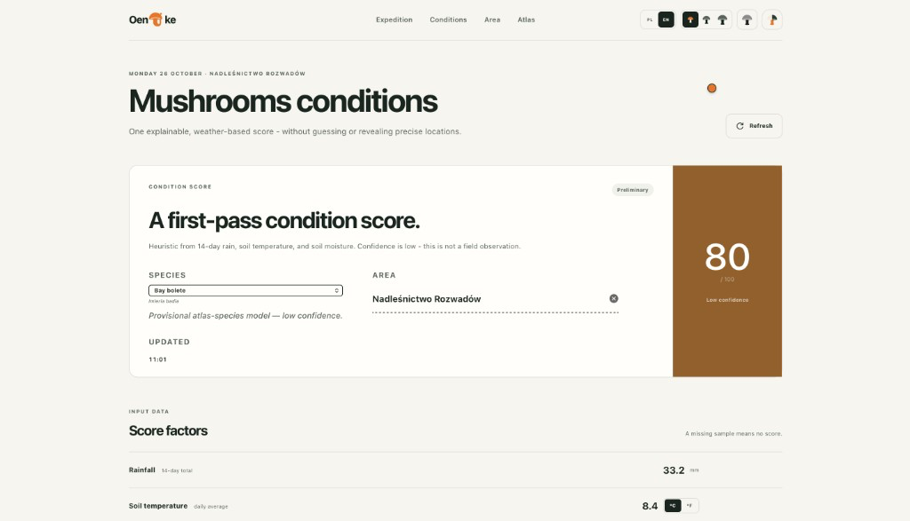
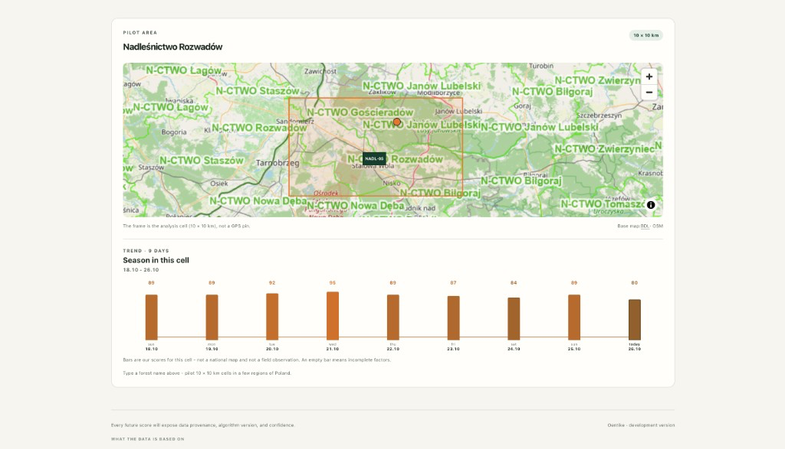

<div align="center">


Mushroom fruiting condition scores for Polish forest districts based on open meteorological data. Includes an offline expedition journal and a versioned botanical atlas.

</div>

---

## Table of Contents

- [Overview](#overview)
- [Architecture & Tech Stack](#architecture--tech-stack)
- [Data Integrity & Reproducibility](#data-integrity--reproducibility)
- [Quick Start](#quick-start)
- [Known Limitations](#known-limitations)
- [Roadmap](#roadmap)
- [Contributing & Security](#contributing--security)
- [License](#license)
- [Screenshots](#screenshots)

---

## Overview

Most mushroom maps rely on crowdsourced pins or broad regional estimates. They rarely explain why conditions are favorable, don't work offline in the field, and sharing exact coordinates publicly can lead to overforaging.

Oentike takes a data-first approach:

- **Weather-based scoring**: Calculates condition scores (0-100) per forest district using precipitation, soil temperature, and soil moisture data from Open-Meteo. Every score displays the underlying factors, algorithm version, and confidence level.
- **Per-species models**: 13 pilot species with calibrated environmental envelopes. If data is insufficient for a species, it remains unscored instead of borrowing another taxon's parameters.
- **Official forest boundaries**: Imports ~429 Polish State Forest districts (*nadleśnictwa*) from GUGiK WFS, each stored as a spatial cell with its own weather history in PostGIS.
- **Offline expedition journal**: Plan routes and save waypoints locally in your browser or desktop app (IndexedDB + GeoJSON). Coordinates stay on your machine.
- **Botanical atlas**: 13 species profiles with vector anatomical illustrations, lookalike comparisons, and cited taxonomy. Designed for botanical reference (no automated photo identification or edibility guarantees).

---

## Architecture & Tech Stack

| Component | Technology | Role |
|---|---|---|
| API | [](./oentike-api) · gRPC + HTTP health | Conditions scoring, season history, cell search, Open-Meteo ingest, BDL sync |
| Database | [](./docker-compose.yml) | Spatial cells (EPSG:2180), weather samples, condition scores, forest units |
| Proto | [](./oentike-proto/conditions.proto) | `ConditionsService` contract: `GetConditions`, `GetSeason`, `SearchCells`, `EnsureCell` |
| Desktop | [](./oentike-web/src-tauri) · Rust 1.97 | Native shell with Core Location (macOS), ed25519 pack verification, gRPC bridge |
| UI | [](./oentike-web) (m.in.: MapLibre, GSAP) | Conditions dashboard, interactive map, expedition planner, species atlas pages |
| Atlas | [JSON Schema 2020-12](./oentike-atlas/schema/card.schema.json) | 13 versioned species cards + 4 anatomical SVGs each; validated before every build |
| Observability | [](./docker-compose.yml) | Optional distributed traces (`OTEL_EXPORTER_OTLP_ENDPOINT`); off by default |
| Tooling | [](./mise.toml) · Taskfile | Pinned Go / Node / Rust / protoc versions; single `./oentike` launcher |
| CI | [](./.github/workflows/ci.yml) | Go tests + gofumpt, Astro build + atlas validation |

### Design Notes

- **Strict contracts (gRPC/Protobuf)**: Factor weights, model versions, and hash checks are strictly typed via Protobuf. The HTTP server is used primarily for container health checks.
- **Spatial queries (PostGIS)**: Forest boundaries are stored as polygons in EPSG:2180 (Poland's PUWG 1992 coordinate system) with spatial indexing for map rendering and nearest-district lookups.
- **Lightweight desktop client (Tauri 2)**: Uses Tauri's Rust backend for direct macOS Core Location integration, ed25519 atlas verification, and small binary size.
- **Content-first frontend (Astro)**: Static generation for atlas entries, hydrating interactive components (m.in.: MapLibre, GSAP) only where needed.
- **Pinned toolchain (mise)**: Runtimes and build tools (Go, Node, Rust, protoc) are version-pinned in `mise.toml` to guarantee reproducible builds.

---

## Data Integrity & Reproducibility

- **Traceable inputs**: Every weather sample stores its `ingest_run_id`, the source request URL, and the SHA-256 hash of the response payload.
- **Explicit missing values**: If weather data is unavailable, the score evaluates to `null` with status `unavailable`. Values are never fabricated or interpolated from distant cells.
- **Versioned models**: Each score is tagged with its `algorithm_version` (e.g. `oentike-conditions/0.1.0-boletus`), making historical calculations auditable.

---

## Quick Start

### Prerequisites

| Tool | Version | Install |
|---|---|---|
| [mise](https://mise.jdx.dev) | latest | `curl https://mise.jdx.dev/install.sh \| sh` |
| [Docker](https://docs.docker.com/get-docker/) + Compose | recent | Docker Desktop or package manager |
| Xcode CLI Tools (macOS) | system | `xcode-select --install` |

### Local Development

```bash
# 1. Clone and pin tool versions
git clone https://github.com/Niutaq/Oentike && cd Oentike
mise trust && mise install

# 2. Verify environment
./oentike doctor

# 3. Install UI dependencies
./oentike setup

# 4. Pull BDL forest districts into PostGIS (~429 nadleśnictwa)
./oentike sync-bdl

# 5. Start everything (PostGIS -> API -> Astro -> Oentike.app)
./oentike dev
```

First run compiles Go + Rust; subsequent starts take seconds.
Use `FORCE_BUILD=1 ./oentike dev` after native code changes.

### Services

| Service | Address |
|---|---|
| UI (Astro dev) | `http://127.0.0.1:4321` |
| HTTP health / ready | `http://127.0.0.1:8081/healthz`, `/readyz` |
| gRPC Conditions | `:8082` |
| PostGIS | `127.0.0.1:54321` (database: `oentike`) |

### Available Commands

| Command | Description |
|---|---|
| `./oentike dev` | PostGIS + API + Astro + desktop app |
| `./oentike field` | Expedition mode (GPS + hot reload, no API) |
| `./oentike field-hot` | Direct `tauri dev` loop for fast UI/Rust iteration |
| `./oentike setup` | Install locked web dependencies |
| `./oentike doctor` | Verify tools and Docker configuration |
| `./oentike check` | Run Go tests, atlas validation, and production build checks |
| `./oentike atlas` | Validate species cards and SVG assets |
| `./oentike bench` | Run spatial lookup and scoring benchmarks |
| `./oentike sync-bdl` | Import BDL forest districts into PostGIS via WFS |
| `./oentike ingest` | Fetch weather for cells (`CELL=<id>` for a single district) |
| `./oentike stop` | Stop background containers |

### Linux

Install Tauri system dependencies once before the first desktop build:

```bash
sudo apt update && sudo apt install -y libwebkit2gtk-4.1-dev build-essential \
  curl wget file libxdo-dev libssl-dev libayatana-appindicator3-dev librsvg2-dev
```

---

## Known Limitations

- **Provisional models**: Weather envelopes evaluate basic physical parameters (rainfall, soil temperature, and moisture). They do not account for mycelium lifecycle stages or specific forest stand tree types. Scores are marked with `low` confidence and are not foraging advice.
- **Packaged desktop builds**: The standalone static application requires a running API service; automatic background daemon management for production bundles is currently in progress. Use `./oentike dev` for full local functionality.
- **API rate limits**: Ingesting weather data for all ~429 districts at once can hit Open-Meteo rate limits. Use targeted ingest (`CELL=<id> ./oentike ingest`) when testing specific areas.
- **GPS availability**: Native Core Location is currently supported on macOS. Linux builds fall back to standard web geolocation in development mode.
- **Single-cell season history**: The trend chart currently renders 9-day history for one selected district rather than aggregate or regional choropleth views.

---

## Roadmap

- [x] Explainable per-species scoring (13 pilot taxa)
- [x] Searchable BDL nadleśnictwa (~429 forest districts)
- [x] Season trend chart (9-day history per cell)
- [x] Offline expedition journal (IndexedDB + GeoJSON)
- [x] Versioned species atlas with anatomical SVG plates
- [x] Core Location integration (macOS `.app` host)
- [x] CI pipeline (Go tests, gofumpt, Astro build, atlas validation)
- [x] Multilingual UI support (PL / EN)
- [ ] Signed atlas distribution packs (ed25519)
- [ ] PMTiles offline basemap cache
- [ ] NATS JetStream event streaming for cache invalidation
- [ ] SPIFFE/SPIRE workload identity and mTLS
- [ ] Sentinel/STAC satellite habitat data integration
- [ ] Regional season choropleth views
- [ ] Local RAG over atlas and conditions notes

---

## Contributing & Security

- Contributions: see [CONTRIBUTING.md](./CONTRIBUTING.md) for code style and pull request requirements.
- Security: see [SECURITY.md](./SECURITY.md) to report vulnerabilities.

> Atlas cards and illustrations are original works. Do not import unverified text or images from external field guides. Illustrations are botanical reference drawings, not a photographic key for edibility determination.

---

## License

See [LICENSE](./LICENSE) for details.

---

## Screenshots

<div align="center">



<p><em>Conditions dashboard: factor breakdown, algorithm version, and confidence level.</em></p>

<br />



<p><em>District map and 9-day season trend view.</em></p>

</div>
