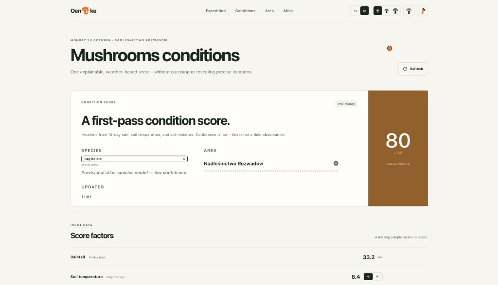
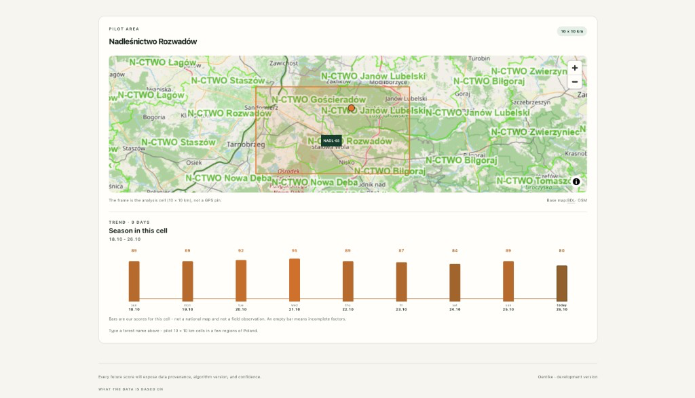

<div align="center">


Local mushroom-conditions helper for Polish forests: explainable scores, a coarse seasonal map, offline atlas later.

[](./oentike-api)
[](./oentike-api/migrations)
[](./oentike-web)

<p>

</p>
<p>

</p>

</div>

---

## Run

One entry point: **`./oentike`**. Prefer [mise](https://mise.jdx.dev) so tool versions match [`mise.toml`](./mise.toml).

### Copy-paste (macOS)

Works from any subdirectory (goes to the git repo root first). Use after clone, `git pull`, or when the UI looks empty:

```bash
cd "$(git rev-parse --show-toplevel)"
mise trust && mise install
./oentike doctor
./oentike setup
./oentike sync-bdl
pkill -f "astro dev" 2>/dev/null || true
FORCE_BUILD=1 ./oentike dev
```

Everyday (shell already built):

```bash
cd "$(git rev-parse --show-toplevel)"
./oentike dev
```

`./oentike` lives in the **repo root** (`Oentike/`), not in `oentike-web/`.

`Ctrl+C` stops API + Astro. Then `./oentike stop` if you also want PostGIS down.

| Command | What it does |
|---|---|
| `./oentike dev` | PostGIS + API + Astro + `Oentike.app` (macOS) / Tauri (elsewhere) |
| `FORCE_BUILD=1 ./oentike dev` | Same, but rebuilds the macOS app shell (ACL / Rust / plist) |
| `./oentike field` | Expedition only (no API); same desktop host as `dev` |
| `./oentike field-hot` | Naked `tauri dev` — fast Rust iteration, **no** Core Location on macOS |
| `./oentike stop` | Stop PostGIS |
| `./oentike setup` | Install web dependencies from the lockfile |
| `./oentike doctor` | Check tools and Docker (no installs) |
| `./oentike check` | Tests, atlas + location contracts, UI production build |
| `./oentike atlas` | Validate species cards and SVG assets |
| `./oentike bench` | Spatial / scoring benchmarks |
| `./oentike sync-bdl` | Pull BDL nadleśnictwa into PostGIS |
| `./oentike ingest` | Refresh Open-Meteo for materialized cells (`CELL=id` optional) |

**macOS:** `dev` / `field` start Astro on `http://127.0.0.1:4321` and open a trusted `Oentike.app` (live UI + Core Location). Conditions data uses Tauri `invoke` over that remote origin — ACL lives in `oentike-web/src-tauri/capabilities/default.json`. If scores stay empty after a native change, use `FORCE_BUILD=1`.

**Linux** (once, before the first desktop build):

```bash
sudo apt update && sudo apt install -y libwebkit2gtk-4.1-dev build-essential curl wget file \
  libxdo-dev libssl-dev libayatana-appindicator3-dev librsvg2-dev
```

| Service | Address |
|---|---|
| HTTP health / ready | `http://127.0.0.1:8081/healthz`, `/readyz` |
| Conditions gRPC | `:8082` |
| PostGIS | `127.0.0.1:54321` · database `oentike` |
| UI (dev) | `http://127.0.0.1:4321` |

---

## Product (pilot)

- Areas: searchable **BDL nadleśnictwa** (~429 after `./oentike sync-bdl`), default **Nadleśnictwo Janów Lubelski** (`nadl-05-31`).
- Species: all **13 pilot atlas cards** have provisional scoring models (separate envelopes per taxon). Unknown slugs stay unscored and never borrow another species’ result.
- Score: versioned heuristics `oentike-conditions/0.1.0-<species>` from Open-Meteo factors (0–100, confidence low). Season chart = last 9 Warsaw days for the selected cell — empty days stay `unavailable`.
- Atlas cards are knowledge only (no photo ID, no consumption advice). Edibility text is informational.
- Expedition (`/expedition/`): local plan → parking → trail → GeoJSON. Data stays on device (IndexedDB). Location needs permission and a visible window; not background navigation. On macOS, location requires the `.app` host from `dev` / `field`.

Optional diagnostics: `OENTIKE_DEBUG_RPC=1`. Traces only if `OTEL_EXPORTER_OTLP_ENDPOINT` is set (e.g. `http://127.0.0.1:4317` after `docker compose up -d jaeger`). Normal `dev` starts PostGIS only.

After changing `oentike-proto/conditions.proto`: `task oentike:proto` (bindings are otherwise committed).

```bash
grpcurl -plaintext -d '{"cell_id":"nadl-05-31"}' \
  127.0.0.1:8082 oentike.conditions.ConditionsService/GetConditions
```

UI field tests: `cd oentike-web && npm run test:field` (and `test:field:browser` after `npx playwright install chromium webkit`).

---

## Layout

| Path | Role |
|---|---|
| `oentike` | Launcher (`./oentike …`) |
| `oentike-api/` | PostGIS migrations, gRPC conditions, Open-Meteo, BDL sync |
| `oentike-proto/` | `conditions.proto` |
| `oentike-web/` | Astro UI + Tauri (`/`, `/atlas`, `/expedition/`) |
| `oentike-atlas/` | Versioned species cards (pilot pack) |
| `docker-compose.yml` | PostGIS |

---

## Known issues

- [ ] **Static / offline `.app` build has empty conditions.** `/api/readyz` is proxied only while Astro dev is running. A packaged app with static `dist` does not reach the API that way. Fix: native readiness check (e.g. Tauri command) and a real `.app` test with the API up. Daily `./oentike dev` on macOS loads live Astro, so the proxy works there.
- Species models are **provisional** (weather envelopes only). They are not field validation and must not be read as forage advice.
